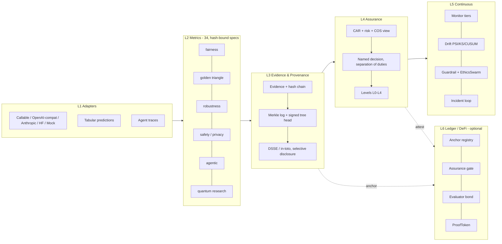

# CATERYA AI Assurance Infrastructure

**Measure. Verify. Assure.**

[](https://github.com/cateryatech/caterya-1.0/actions/workflows/ci.yml)


Open, vendor-neutral infrastructure that **evaluates AI systems**, produces **verifiable evidence** about their behaviour and risk,
preserves **tamper-evident provenance**, and supports **continuous assurance** across the AI lifecycle — with optional research
(quantum) and public-ledger (blockchain / DeFi) layers on top.

> Author / owner: **Ary H Haryanto (Ary HH)** · **Caterya Tech** · Apache-2.0 · version `1.0.0-alpha.1`

**Why it exists.** Claims about AI systems — "fair", "robust", "compliant" — are routinely made without evidence that anyone else can check.
CATERYA makes the *evidence* the product: every result says what was measured, how, on what, by whom, with which limitations — and, just as
importantly, what was **not** tested.

---

## What it is — and is not

| It **is** | It is **not** |
|---|---|
| A toolkit that turns measurements into **signed, hash-chained, reproducible Evidence** | A certification, safety guarantee or legal-conformity assessment |
| Explicit about **what was not tested** (a gap is never a pass) | A single "ethics score" (a composite **COS** index exists, but only as a *derived* view) |
| Stdlib-only core; every heavy/optional dependency is opt-in | A source of performance or regulatory claims (none are made) |
| A human-in-the-loop design: named deciders, separation of duties, signed overrides | An autonomous gatekeeper: guardrails *recommend*; holds need a signed standing authorization |
| Honest about maturity (stable / research / untested-on-public-networks) | Quantum-advantage or zero-knowledge software (neither is claimed — see below) |

## Install

```bash
pip install caterya                    # core: standard library only
pip install "caterya[crypto]"          # real Ed25519 signatures (required for assurance level >= 2)
pip install "caterya[all]"             # + REST/GraphQL API, web3 clients, telemetry
pip install "caterya[quantum-backends]"  # opt-in heavy: PennyLane + Qiskit/Aer
```

> **Not yet published to PyPI?** Install from source: `pip install -e ".[dev,all]"`. Without `cryptography`, CATERYA falls back to a
> **dev-only HMAC signer** (loudly) and evidence can never exceed assurance level 1.

## 60-second tour

```bash
caterya demo --flaws pii,bias --out out/        # end-to-end on a mock system: evaluate -> reproduce -> decide -> attest -> anchor
caterya evidence verify out/bundle.json         # anyone can verify offline, no private keys needed
caterya list metrics                            # 34 registered metrics (generated catalogue: docs/METRICS.md)
```

```python
from caterya import AssuranceEngine, SystemConfig, CallableAdapter

system = SystemConfig("support-bot", "2.3.0", owner="Acme", intended_use="customer support", description="RAG assistant",
                      risk_context={"impact": 3, "exposure": 4, "context": 3})
adapter = CallableAdapter(generate=lambda prompt, **kw: my_model(prompt))      # any callable; also OpenAI-compatible, Anthropic, HF

engine = AssuranceEngine(system, profile="CATERYA-LLM")
report = engine.evaluate(adapter)
print(report.summary())                      # PASS / FAIL / INFO / UNTESTED per metric, risk, coverage, recommendation

reproduced = engine.reproduce(report)        # re-runs from the same inputs/seed and compares
# a *human* with their *own key* decides (see examples/06 and docs/ASSURANCE_LEVELS.md)
```

Prediction-level data (labels, scores, groups — no model access needed) works too:

```python
from caterya import TabularData
engine.evaluate(profile="CATERYA-TABULAR", tabular=TabularData(y_true=y, y_prob=p, groups={"gender": g}))
```

More in [`examples/`](examples) — quick-start, tabular fairness, agents, custom metrics, CI gate, guardrails/monitoring, quantum, on-chain gate,
one-call evaluator. Every example is executed by the test-suite.

## Core ideas

* **Evidence is the unit of output.** Each metric result is an `Evidence` record bound to the metric **definition** (`spec_hash`), the
  **system** and **dataset** hashes, the seed, a confidence interval and the stated limitations; it is hash-chained, Ed25519-signed and
  committed to an RFC 6962-style Merkle log. → [docs/EVIDENCE_SPEC.md](docs/EVIDENCE_SPEC.md)
* **Untested ≠ passed.** Missing inputs, crashed metrics, unavailable backends and groups below the minimum size become visible *gaps*
  that lower coverage and can force `INSUFFICIENT_EVIDENCE`.
* **Thresholds are policy, not science.** Defaults are illustrative; you own them. → [docs/PARAMETERS.md](docs/PARAMETERS.md),
  [docs/VALIDATION_PROTOCOL.md](docs/VALIDATION_PROTOCOL.md)
* **Assurance levels describe the *process*** (integrity → reproduced → independently decided → independently attested and anchored),
  never the safety of the system. → [docs/ASSURANCE_LEVELS.md](docs/ASSURANCE_LEVELS.md)
* **The recommendation is not the decision.** A named human decides; contradicting a recommendation requires a written override.
* **No silent substitution.** Requested backends (Qiskit, PennyLane, EVM, IPFS, ZK) either work or fail visibly.

## Architecture



| Layer | Package | Maturity |
|---|---|---|
| Core, hashing, stats | `caterya.core` | stable (alpha API) |
| Adapters | `caterya.adapters` | stable; hosted adapters tested against a local HTTP server, not live vendors |
| Metrics (34) | `caterya.metrics` | stable ×29, **research ×5** (`behavioral_lyapunov`, `sustainability_estimate`, 3 × quantum) |
| Evidence, Merkle, DSSE | `caterya.provenance` | stable |
| Engine, profiles, risk, levels, governance | `caterya.assurance` | stable (alpha API) |
| Monitoring, guardrails, swarm | `caterya.monitoring`, `caterya.guardrails` | stable (alpha API) |
| Quantum | `caterya.quantum` | **research**; pure-Python simulator + opt-in PennyLane (cross-checked) / Qiskit (code path **not** exercised in CI) |
| EVM clients + Solidity | `caterya.blockchain`, `contracts/` | tested on an **in-process EVM**; **unaudited**; not run on public networks |
| IPFS (Kubo) | `caterya.blockchain.ipfs` | **untested** against a live node (local content store is tested) |
| ZK | `caterya.blockchain.zk` | **interface only** — no prover exists here |
| REST / GraphQL / CLI | `caterya.api`, `caterya.cli` | alpha; in-memory state (see roadmap) |

## Quantum (research)

`caterya.quantum` offers a swap-test **quantum symmetry index**, swap-test **fidelity** and an **entanglement-entropy** dependence
measure over amplitude-encoded group score distributions. The default is a deterministic pure-Python simulator; PennyLane and Qiskit are
opt-in and **never substituted silently**. Results record backend, version, shots, seed and circuit hash. **No quantum advantage is claimed**;
these are research instruments next to — never instead of — the classical metrics. → [docs/QUANTUM.md](docs/QUANTUM.md)

## Blockchain / DeFi (optional)

* `CateryaAnchorRegistry` — public timestamp of evidence Merkle roots (evidence stays off-chain).
* `CateryaAssuranceGate` — on-chain attestations keyed by system hash; `isAssured(systemHash, minLevel)` is what other protocols call.
  Revocation and expiry take effect immediately for consumers.
* `CateryaEvaluatorBond` — skin-in-the-game: bonded evaluators, delayed withdrawal, arbiter slashing (a *trusted* governance role).
* `ProofToken` — compact signed "system S holds level L until T" for gateways/keepers that cannot afford an RPC call per request.
* No token is issued, nothing here is financial advice, and the contracts are **unaudited reference implementations**.
  → [docs/BLOCKCHAIN_DEFI.md](docs/BLOCKCHAIN_DEFI.md)

## Verification status

What is verified, and how, is listed claim-by-claim in [docs/CLAIMS.md](docs/CLAIMS.md). In short: the test-suite includes **flaw-injection
tests** proving each metric detects the failure it claims to detect, tamper/forgery tests for the evidence chain, separation-of-duty tests
for the levels, **contract tests on an in-process EVM**, and tests that run every example and regenerate the docs. CI also runs the suite with
**zero optional dependencies** to keep the "stdlib-only core" claim honest.

```bash
pip install -e ".[dev,all]" && pytest            # full suite
pip install -e . pytest && pytest                # core only; extras-dependent tests skip
python scripts/gen_docs.py                       # regenerate METRICS.md / PARAMETERS.md / REGULATORY.md / schemas/
node contracts/scripts/compile.js                # recompile contracts (npm i solc@0.8.26)
```

## Honesty policy

1. We state **limitations** with every metric and every Evidence record.
2. We make **no performance claims**; `benchmarks/bench.py` prints what *you* measure on *your* hardware.
3. **Regulatory mapping is thematic and indicative** — coverage is not conformity, and none of this is legal advice.
4. Anything not exercised by tests is labelled so (see the maturity table and [docs/ROADMAP.md](docs/ROADMAP.md)).

## Project

[Architecture](docs/ARCHITECTURE.md) · [Evidence spec](docs/EVIDENCE_SPEC.md) · [Levels](docs/ASSURANCE_LEVELS.md) ·
[Guardrails](docs/GUARDRAILS.md) · [Integration recipes](docs/INTEGRATION.md) · [Threat model](docs/THREAT_MODEL.md) ·
[Design decisions](docs/DESIGN_DECISIONS.md) · [Roadmap](docs/ROADMAP.md) · [Governance](governance/CHARTER.md) ·
[Contributing](CONTRIBUTING.md) · [Security](SECURITY.md) · [Changelog](CHANGELOG.md)

Indonesian summary: [README.id.md](README.id.md). Cite via [CITATION.cff](CITATION.cff).

© Caterya Tech · Ary H Haryanto — licensed under the [Apache License 2.0](LICENSE).
